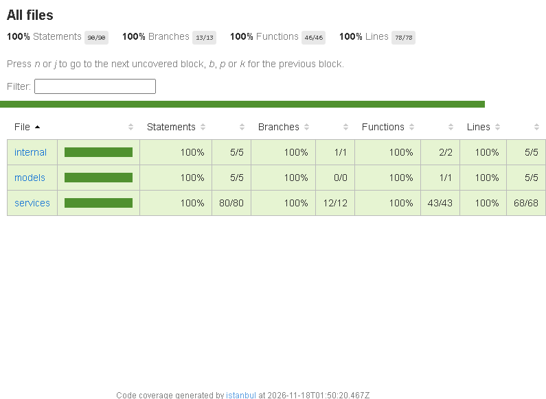
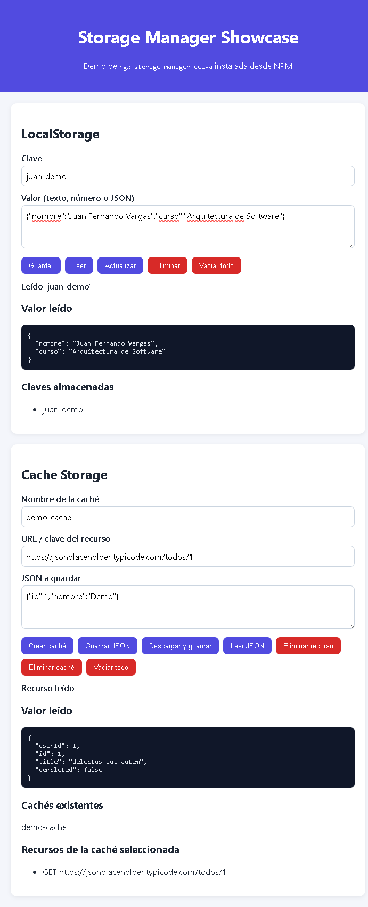
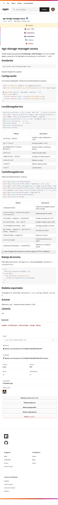

# Entrega — ngx-storage-manager-uceva

## Autores

- Valentina González Mejia
- Juan Fernando Vargas

## Enlaces

- Repositorio: [STORAGE-MANAGER-PROJECT](https://github.com/valentina19-07/STORAGE-MANAGER-PROJECT)
- Paquete NPM: [ngx-storage-manager-uceva](https://www.npmjs.com/package/ngx-storage-manager-uceva)
- Documentación Compodoc: [índice](./storage-manager-lib/documentation/index.html)

La versión `1.0.0` está publicada en NPM. El Showcase declara el paquete como dependencia normal y se verificó con una instalación limpia (`npm ci`, `npm install ngx-storage-manager-uceva@1.0.0`) y compilación de producción.

## Evidencias

### Cobertura

100% en Statements (90/90), Branches (13/13), Functions (46/46) y Lines (78/78).

### Compodoc

- Servicios: [LocalStorageService](./storage-manager-lib/documentation/injectables/LocalStorageService.html) y [CacheStorageService](./storage-manager-lib/documentation/injectables/CacheStorageService.html)
- Modelos: [StorageError](./storage-manager-lib/documentation/classes/StorageError.html) y [CacheEntry](./storage-manager-lib/documentation/interfaces/CacheEntry.html)
- Capturas: [LocalStorageService](./evidence/02-compodoc.png), [CacheStorageService](./evidence/02-compodoc-cache-storage.png), [StorageError](./evidence/02-compodoc-storage-error.png) y [CacheEntry](./evidence/02-compodoc-cache-entry.png)

### Showcase

Captura tomada después de guardar y leer un dato en LocalStorage, crear la caché, descargar y leer un recurso.

### NPM

Paquete publicado: [`ngx-storage-manager-uceva@1.0.0`](https://www.npmjs.com/package/ngx-storage-manager-uceva).

